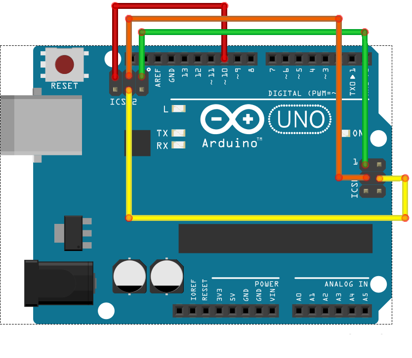
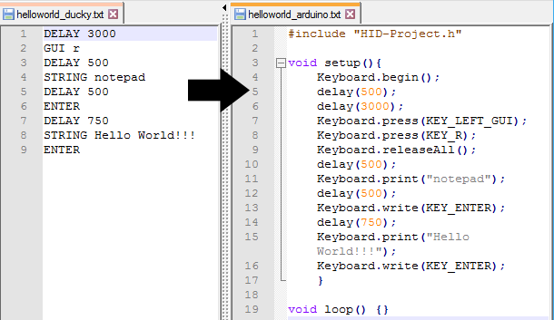

In theory, the Arduino UNO can't act as an HID device, which is what we need to turn it into a USB Rubber Ducky. However, this board has two microcontrollers, the ATmega328 and the ATmega16u2, and the second one is the one we care about. This microcontroller can be reprogrammed to work as a USB AVR (just like an Arduino Leonardo would, for example), which is what lets us emulate an HID device and build our own USB Rubber Ducky.

To get this extra feature we need to flash a new bootloader called HoodLoader2, made by [NicoHood](https://www.nicohood.de/). The source code is available on his [Github](https://github.com/NicoHood/HoodLoader2).

The first step to flash this bootloader is uploading the installation sketch to the Arduino with the Arduino IDE (you can download it from [here](https://github.com/NicoHood/HoodLoader2/tree/master/avr/examples/Installation_Sketch)), the same way we would with any other sketch we wrote ourselves. Once that's done, we need to do a bit of wiring on the board so the bootloader can be flashed automatically.

This is the wiring we need:



After that, we plug the Arduino back into a USB port and the new bootloader starts flashing automatically. Right after plugging it in, the LED blinks slowly for 10 seconds, then the flashing process starts and takes around 30 seconds. When it finishes, the same LED blinks fast (every 100ms).

If the LED keeps blinking slowly (every second), the installation failed, and it will try to flash itself again in 10 seconds.

The whole HoodLoader2 installation process is explained in much more detail on its Github: <https://github.com/NicoHood/HoodLoader2/wiki/Installation-sketch-(standalone-Arduino-Uno-Mega)>.

Now the board has the new bootloader, but the Arduino IDE won't recognize it and won't let us upload our sketches, so we need to install the board definitions for HoodLoader2. It's a really simple process and the steps are here: <https://github.com/NicoHood/HoodLoader2/wiki/Software-Installation>.

Once the Arduino IDE recognizes the board, we can upload a test sketch and check that it runs correctly:

```c
#include "HID-Project.h"

void setup() {
    Keyboard.begin();
    delay(500);

    Keyboard.press(KEY_LEFT_GUI);
    Keyboard.press(KEY_R);
    Keyboard.releaseAll();
    delay(500);
    Keyboard.println("cmd.exe");
    delay(500);
    Keyboard.println("calc.exe");
}

void loop() {}
```

As you can see, we use the "[HID-Project](https://github.com/NicoHood/HID)" library.
This library lets us use Keyboard.println() to send a string followed by an Enter. If we didn't want the final Enter, we would use Keyboard.print().
If we need to send a key combination, we can simulate pressing the keys with Keyboard.press(), and once the combination is sent, release them with Keyboard.releaseAll().

All that's left is plugging the Arduino into the computer we want to test it on and waiting. In this case it seems to work perfectly, opening the calculator :P


To be able to use scripts designed for the original USB Rubber Ducky, I wrote a small script that converts each function into its Arduino equivalent and automatically generates the full sketch, ready to upload to the board. It may have some bugs, but the ones I've tested worked perfectly.

Ducky2Arduino: [https://github.com/kr0no/Ducky2Arduino](https://github.com/kr0no/Ducky2Arduino)

As a simple example, the Rubber Ducky Hello World script would look like this as an Arduino sketch:

```console
~$ ducky2arduino.py helloword_ducky.txt helloword_arduino.txt
```



This is all a few years old now, but I had an Arduino UNO lying around at home and wanted to put it to some use. If you want to do this today, there's a much simpler way: just get something like a Teensy or an Arduino Zero, since they can emulate HID devices natively without any trouble.
