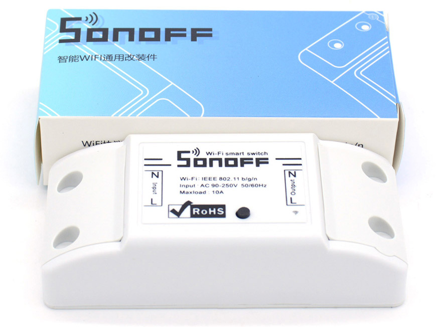
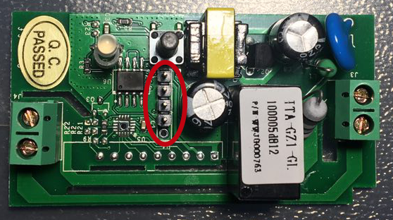

ITead's Sonoff devices let us build a _"smart home"_ really cheaply and very easily. However, these devices are managed through Sonoff's own servers, so they're constantly sending and receiving commands from a place that isn't under our control, and it's better to avoid that, right?

In this post we're going to see how to reflash the [Sonoff Wifi Smart Switch](https://www.itead.cc/smart-home/sonoff-wifi-wireless-switch.html) (which costs $4.85 (~4.50€)) so it uses our own MQTT server and everything is handled from our local network.



To reprogram the device we need a USB to serial-TTL adapter (I use [this one](https://www.amazon.es/gp/product/B01C2P9GD2)), and four pins to solder onto the switch board.

Next to the switch's button there are five holes meant for soldering a row of pins. We just have to solder a row of four pins into these holes (we don't need the fifth one), as shown in the following picture:


Once that's done, we have to connect the switch to the USB serial-TTL adapter like this:
- The first pin (starting from the one with the square pad, the closest to the button) goes to the 3.3v output of the USB adapter.
- The second pin is RX, we connect it to the adapter's TX.
- The third pin is TX, we connect it to the adapter's RX.
- The fourth pin is GND, we connect it to one of the adapter's GND pins.

With everything connected, we can move on to programming the switch. To boot the Sonoff in programming mode, we have to hold the button down before plugging the adapter into the PC.

Once we're finally in programming mode, we can upload our own sketch to the switch. These are the settings to load the sketch onto the board correctly:
- Board: Generic ESP8266 Module
- Flash mode: DIO
- Flash size: 1M (64K SPIFFS)
- Reset method: ck

We also need a fork of the PubSubClient library with MQTT support, available [here](https://github.com/Imroy/pubsubclient).

After these steps we can load the new sketch onto the board without any problems:

```cpp
//Based on a KmanOz work: https://github.com/KmanOz/Sonoff-HomeAssistant/blob/master/arduino/ESPsonoff-v1.01p/ESPsonoff-v1.01p.ino

//Needs PubSubClient with MQTT support: https://github.com/Imroy/pubsubclient

#include <EEPROM.h>
#include <ESP8266WiFi.h>
#include <PubSubClient.h>
#include <Ticker.h>

#define BUTTON          0
#define RELAY           12
#define LED             13

#define WIFI_SSID       "SSID"
#define WIFI_PASS       "PASSWORD"

#define MQTT_CLIENT     "MQTT_CLIENT"
#define MQTT_SERVER     "MQTT_SERVER_IP"
#define MQTT_PORT       1883
#define MQTT_TOPIC      "mqtt/topic"

#define MQTT_AUTH       true
#define MQTT_USER       "user"
#define MQTT_PASS       "pass"

//logic
bool sendStatus = true;
bool restart = false;
int lastState = true;
unsigned long TTasks;
unsigned long count = 0;

extern "C" {
  #include "user_interface.h"
}

WiFiClient wifiClient;
PubSubClient mqttClient(wifiClient, MQTT_SERVER, MQTT_PORT);
Ticker ticker;

void callback(const MQTT::Publish& pub) {
  if(pub.payload_string() == "stat") {
  } else if(pub.payload_string() == "on") {
    digitalWrite(LED, LOW);
    digitalWrite(RELAY, HIGH);
  } else if(pub.payload_string() == "off") {
    digitalWrite(LED, HIGH);
    digitalWrite(RELAY, LOW);
  } else if(pub.payload_string() == "reset") {
    restart = true;
  }
  sendStatus = true;
}

void setup() {
  pinMode(LED, OUTPUT);
  pinMode(RELAY, OUTPUT);
  pinMode(BUTTON, INPUT);
  digitalWrite(LED, HIGH);
  digitalWrite(RELAY, LOW);
  Serial.begin(115200);
  EEPROM.begin(8);
  lastState = EEPROM.read(0);
  if(lastState == 1) {
    digitalWrite(LED, LOW);
    digitalWrite(RELAY, HIGH);
  }
  ticker.attach(0.05, button);
  mqttClient.set_callback(callback);
  WiFi.mode(WIFI_STA);
  WiFi.begin(WIFI_SSID, WIFI_PASS);
  while(WiFi.status() != WL_CONNECTED) {
    delay(500);
  }
  if(WiFi.status() == WL_CONNECTED) {
    Serial.println("IP: " + WiFi.localIP());
    if(MQTT_AUTH) {
      while(!mqttClient.connect(MQTT::Connect(MQTT_CLIENT).set_keepalive(90).set_auth(MQTT_USER, MQTT_PASS))) {
        delay(1000);
      }
    } else {
      while(!mqttClient.connect(MQTT::Connect(MQTT_CLIENT).set_keepalive(90))) {
        delay(1000);
      }
    }
    if(mqttClient.connected()) {
      mqttClient.subscribe(MQTT_TOPIC);
      if(digitalRead(RELAY) == HIGH)  {
        digitalWrite(LED, LOW);
      } else {
        digitalWrite(LED, HIGH);
      }
    }
  }
}

void loop() {
  mqttClient.loop();
  timedTasks();
  checkStatus();
}

void button() {
  if(!digitalRead(BUTTON)) {
    count++;
  } else {
    if(count > 1 && count <= 40) {
      digitalWrite(LED, !digitalRead(LED));
      digitalWrite(RELAY, !digitalRead(RELAY));
      sendStatus = true;
    } else if(count > 40) {
      restart = true;
    }
    count = 0;
  }
}

void checkConnection() {
  if(WiFi.status() == WL_CONNECTED) {
    if(!mqttClient.connected()) {
      restart = true;    
    }
  } else {
    restart = true;
  }
}

void checkStatus() {
  if(sendStatus) {
    if(digitalRead(LED) == LOW) {
      EEPROM.write(0, 1);
      mqttClient.publish(MQTT::Publish(MQTT_TOPIC"/stat", "on").set_retain().set_qos(1));
    } else {
      EEPROM.write(0, 0);
      mqttClient.publish(MQTT::Publish(MQTT_TOPIC"/stat", "off").set_retain().set_qos(1));
    }
    EEPROM.commit();
    sendStatus = false;
  }
  if(restart) {
    ESP.restart();
  }
}

void timedTasks() {
  if ((millis() > TTasks + (60000)) || (millis() < TTasks)) { 
    TTasks = millis();
    checkConnection();
  }
}
```

To finish, we restart the switch to check that it automatically connects to the configured wifi network and MQTT server, taking Sonoff's servers out of the picture :P

If everything works correctly, we can now connect it to mains power and put it to the use we had in mind.
